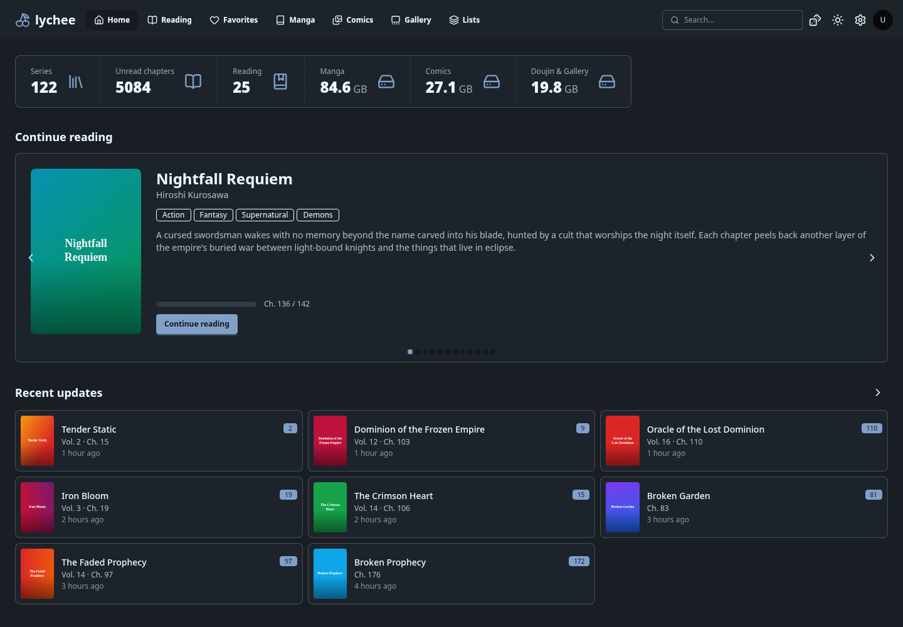
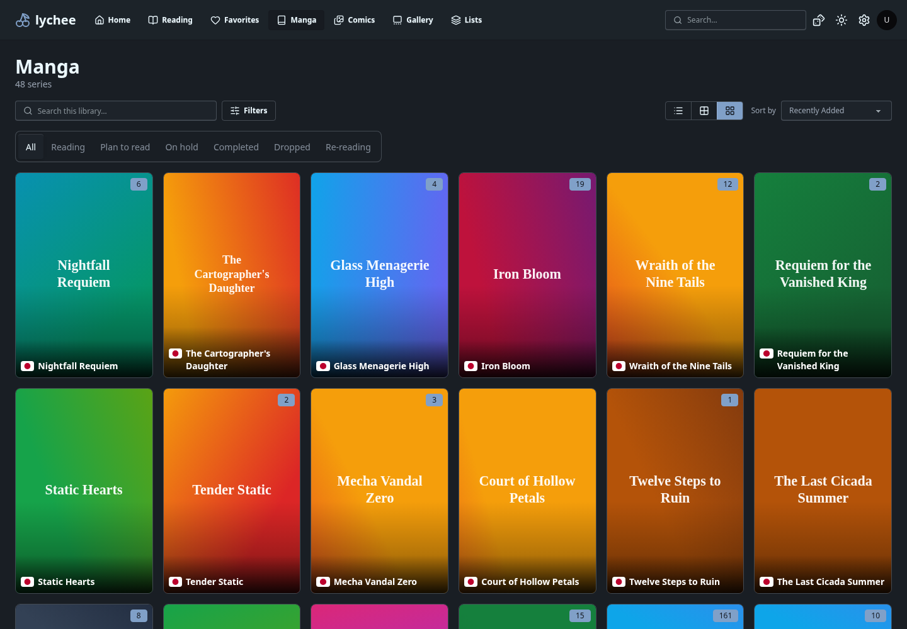
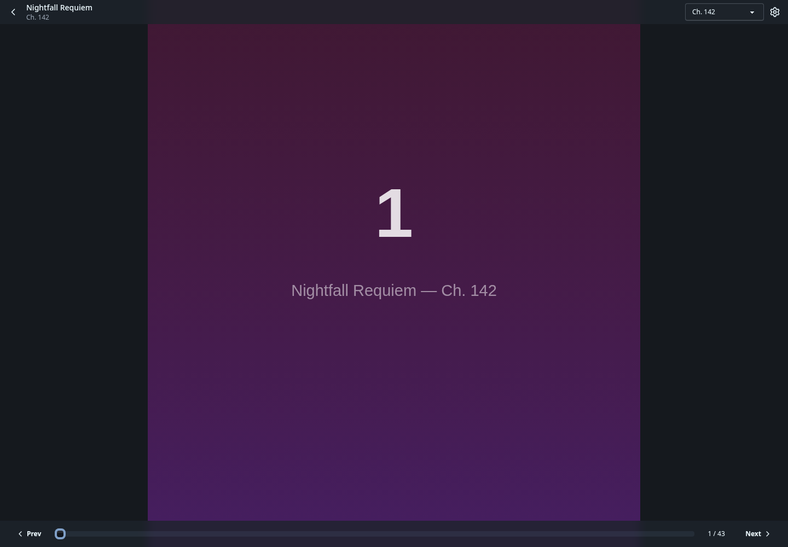

# lychee

Current release: **v0.1.0-beta.7** — reliable Favorites updates across manga, comics, and galleries, including cached views and pending saves.

Self-hosted manga, comic, and art-gallery media server. Point it at folders on
disk, scan your library, and read in the browser with progress tracking.

[Interface tour](docs/README.md) · [Try the demo](#try-the-interface-without-a-backend) · [Run locally](#run-locally) · [Architecture](notes/decisions/README.md)



_Screenshots use the local MSW demo: fictional titles, generated placeholder art,
and simulated accounts, downloads, and server statistics._

## What it does

- **Scan and browse:** index CBZ/ZIP archives and image directories; browse manga,
  comics, and galleries with search, filters, sorting, and saved filter presets.
- **Read:** single-page, double-page, and long-strip layouts; left-to-right or
  right-to-left controls; fit settings and saved reading progress.
- **Organize:** favorites, reading shelves, personal ratings, custom lists,
  editable metadata, tags, and aliases.
- **View galleries:** image/GIF grids and a full-screen lightbox, with browser
  playback for supported video formats. System `ffmpeg` enables video posters.
- **Connect services:** MangaDex metadata matching, covers, chapter downloads,
  and account sync; reading tracker connections for AniList, MyAnimeList, and
  MangaUpdates.
- **Import:** register existing folders or import CBZ/ZIP files and image folders,
  with AVIF conversion, filename patterns, and reusable presets.
- **Follow background work:** live scan, download, import, and sync updates in the
  interface. An optional MCP server exposes library operations to agent clients.

The current reader supports CBZ/ZIP and image directories. PDF, EPUB, RAR, and
7z support are outside the current scope; see the [build plan](notes/plan.md).

## A look around

### Library



Switch between list, compact, and gallery views. The [interface tour](docs/README.md)
includes all three, advanced filters, reading lists, galleries, and every settings
panel.

### Reader



Keyboard arrows turn pages according to the reading direction. Escape closes
reader settings, then returns to the previous page.

## Try the interface without a backend

With Bun and `just` installed, run:

```sh
just fe-install
just fe-mock
```

Open **http://localhost:5173**. The local
[MSW harness](frontend/src/mocks/) supplies the library, artwork, chapter pages,
settings, and simulated task events. No database, backend process, provider
credentials, or external image service is needed. Demo edits reset on a full
page reload.

## Run locally

Prerequisites: Python **3.14**, Node **24 LTS**, Bun **1.4.4**,
[`uv`](https://docs.astral.sh/uv/), and [`just`](https://github.com/casey/just).

Install the backend and frontend dependencies:

```sh
just be-install fe-install
```

Start the backend in one terminal:

```sh
just be-dev
```

Start the frontend in another:

```sh
just fe-dev
```

Open **http://localhost:5173**. The development frontend proxies `/api` to the
backend at **http://localhost:8000**; API documentation is available at
**http://localhost:8000/docs**. The backend applies database migrations on startup.

In **Settings → Libraries**, add a folder using the path visible to the server,
then start a scan. The [interface tour](docs/README.md#libraries-and-local-import)
shows registration, the storage browser, and import controls.

Configuration is documented in [backend/.env.example](backend/.env.example).
The defaults use SQLite and local storage under `backend/`. Copy the example to
`backend/.env` to customize them. Set `LYCHEE_SECRET_KEY` before connecting
provider or tracker accounts; it encrypts their stored credentials.

For the optional agent interface, see [mcp/AGENTS.md](mcp/AGENTS.md).
Run `just` or `just --list` to see all development, database, and test commands.

## Development

| Surface  | Stack                                                                   |
| -------- | ----------------------------------------------------------------------- |
| Backend  | Python 3.14, FastAPI, SQLAlchemy 2.1, Alembic, SQLite                   |
| Frontend | Vue 3, TypeScript native bridge, Vite+, Tailwind CSS v4, DaisyUI 5, Bun |
| MCP      | Python 3.14, FastMCP, HTTP client over the backend API                  |

Run `just check` for formatting, lint, types, tests, and coverage gates across all
three surfaces. The frontend enforces **85% minimum coverage for lines,
statements, functions, and branches**, with stricter critical-file gates.

Use `just be-coverage`, `just fe-coverage`, or `just mcp-coverage` for individual
reports. See the [testing review](notes/testing.md) for measured results and
remaining gaps, and the [dependency review](notes/dependency-modernization.md)
for toolchain compatibility notes.

After an API schema or router change, run `just api-gen` to regenerate both the
backend OpenAPI document and the frontend types.

## Project notes

- [User interface and screenshot tour](docs/README.md)
- [Build plan and feature status](notes/plan.md)
- [Architecture decisions](notes/decisions/README.md)
- [Code-quality backlog](notes/refactor.md)
- [Screenshot sources and capture notes](docs/assets/README.md)

Lychee's core scan, catalog, reading, gallery, and integration flows are
implemented. The build plan records remaining work and deliberate exclusions.

[MIT license](LICENSE).
